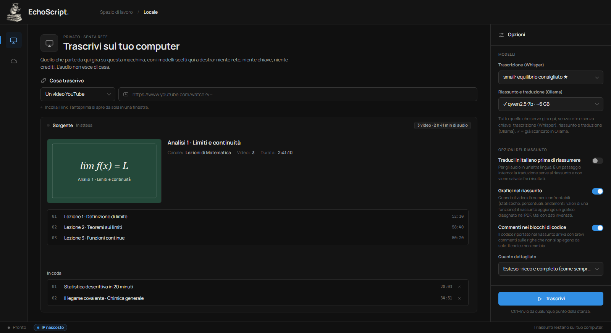
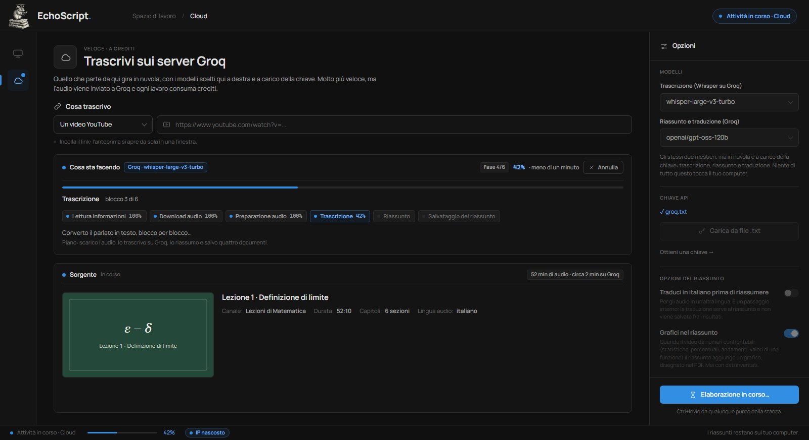
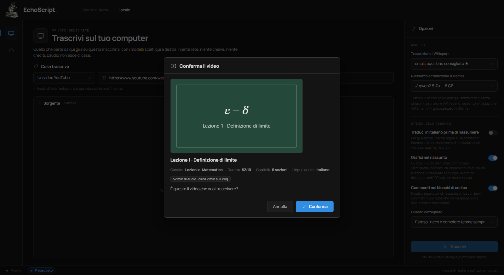
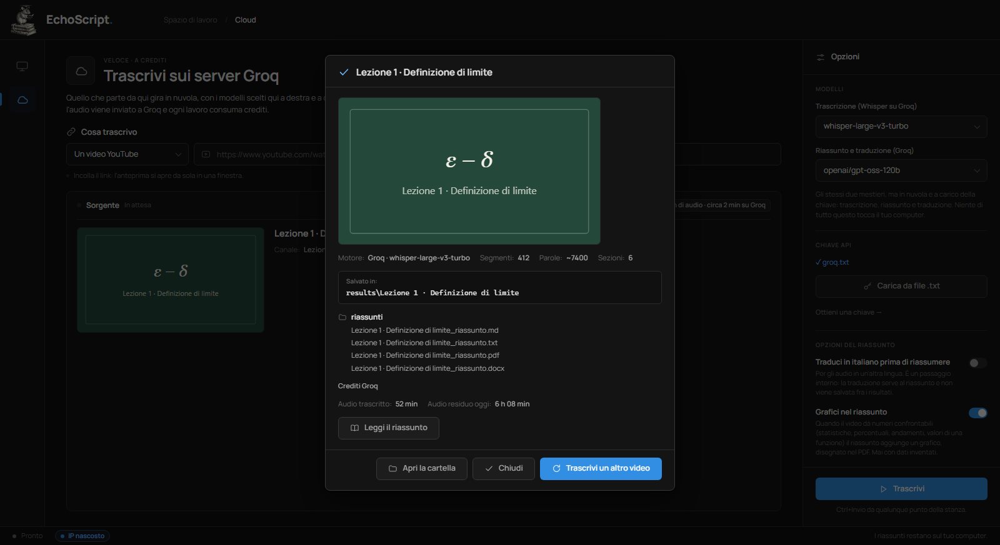

<p align="center">
  
</p>

<h1 align="center">EchoScript</h1>

<p align="center">
  <b>Trascrivi. Traduci. Riassumi. Capisci di più.</b><br>
  Da un video YouTube o da un file audio a un riassunto pulito, con formule, grafici<br>
  e molecole disegnati: per studiare un video lungo leggendolo invece di guardarlo per ore.
</p>

<p align="center">
  
  
  
  
  
  
  
</p>

<p align="center">
  <a href="#uno-sguardo-allapp">Uno sguardo</a> ·
  <a href="#a-cosa-serve">A cosa serve</a> ·
  <a href="#perché-echoscript">Perché</a> ·
  <a href="#download">Download</a> ·
  <a href="#locale-o-cloud">Locale o Cloud</a> ·
  <a href="#riassunti-per-materia">Materie</a> ·
  <a href="#avvio-rapido">Avvio rapido</a> ·
  <a href="#licenza-e-crediti">Licenza</a>
</p>

<br>

> [!NOTE]
> L'installatore è per **Windows 10 e 11 a 64 bit**. Su macOS e Linux EchoScript si usa
> per ora dal codice, vedi [Avvio rapido](#avvio-rapido).

## Uno sguardo all'app

<table>
  <tr>
    <td width="50%" valign="top">
      
      <sub><b>Locale.</b> Incolli un link o scegli un file: quello che c'è dietro finisce nella sorgente, e gli altri si mettono in coda. A destra i modelli e le opzioni del riassunto.</sub>
    </td>
    <td width="50%" valign="top">
      
      <sub><b>Cloud.</b> Mentre lavora si vede a che fase è, con la sua percentuale e il tempo che manca. La barra in fondo lo ripete da qualunque stanza.</sub>
    </td>
  </tr>
  <tr>
    <td width="50%" valign="top">
      
      <sub><b>Anteprima.</b> Il link si legge da solo: titolo, durata e stima arrivano prima di partire, così un link sbagliato si scopre subito.</sub>
    </td>
    <td width="50%" valign="top">
      
      <sub><b>Risultato.</b> A lavoro finito, i quattro documenti e dove sono. «Leggi» apre il riassunto con formule e grafici già disegnati.</sub>
    </td>
  </tr>
</table>

<sub>Nelle schermate il video e la playlist sono contenuti di esempio.</sub>

## A cosa serve

Incolli un link di YouTube o scegli un file dal disco. EchoScript scarica solo l'audio,
lo trascrive, se serve lo traduce in italiano, e ne scrive un riassunto. Il riassunto è
l'unica cosa che finisce fra i risultati: trascrizione e traduzione sono passaggi per
arrivarci.

| Passaggio | Cosa fa |
|---|---|
| 🔎 **Anteprima** | Appena incolli il link legge titolo, durata e copertina e te li mostra in una finestra: un link sbagliato si scopre prima di spendere mezz'ora, o dei crediti. |
| 🧅 **Download** | Scarica solo l'audio, che pesa dieci volte meno del video. Tutto quello che va verso YouTube passa da **Tor**. |
| 🎙 **Trascrizione** | Whisper, sul tuo computer oppure sui server Groq. Stesso modello, cambia chi fa i conti. |
| 🌍 **Traduzione** | A richiesta, per gli audio in un'altra lingua. |
| 📝 **Riassunto** | Esteso, normale, breve o solo i punti chiave. Senza «ehm», ripetizioni e autocorrezioni, e con formule, grafici, molecole e codice commentato [secondo la materia](#riassunti-per-materia). |
| 📄 **Documenti** | Markdown, testo, PDF impaginato e Word. **«Leggi»** apre il riassunto in una finestra, con formule e grafici già disegnati. |

Funziona anche su **playlist intere** e su **cartelle di file audio**, e c'è una **coda**:
incolla più link insieme (uno per riga), oppure incollane uno nuovo mentre un lavoro è in
corso, e verranno trascritti in fila. Basta anche **Ctrl+V** in qualunque punto della
finestra.

Oltre alla finestra c'è una **riga di comando** (`python cli/main.py`) che fa le stesse
cose con dei menu nel terminale.

## Perché EchoScript

- **Niente abbonamenti, niente minutaggio.** In locale non c'è nessun limite se non il tempo. In cloud bastano i crediti gratuiti di Groq.
- **Due stanze, due lavori insieme.** «Locale» e «Cloud» sono due postazioni indipendenti: mentre Groq trascrive sui suoi server, il tuo computer può trascriverne un altro. Un puntino sull'icona dice cosa succede nella stanza che non stai guardando.
- **Non mostra il tuo indirizzo a YouTube.** Ogni richiesta passa da Tor, e la spia nella barra di stato dice se l'IP è nascosto. Se Tor non parte, EchoScript non scarica: meglio un lavoro fermo che uno a viso scoperto.
- **Niente di inventato.** Un grafico si fa solo con i numeri detti nel video o calcolabili dalle sue formule. Una molecola si disegna solo se la struttura torna con la formula, una reazione solo se è bilanciata. Quello che non supera il controllo si scarta.
- **Un lavoro si segue, e si riprende.** Ogni fase ha la sua percentuale e una stima del tempo che manca. Se qualcosa si interrompe (rete, crediti finiti, finestra chiusa) reincollando lo stesso link compare **«Riprendi»**, che riparte dal punto esatto.
- **Dice le cose come stanno.** Se i crediti Groq non bastano lo dice prima di partire. Se finiscono a metà dice a che ora tornano, e propone di finire sul computer. Un errore apre una finestra con la causa in italiano e il testo tecnico sotto.

## Download

| Sistema | File | Note |
|---|---|---|
| **Windows** 10 e 11 | [`EchoScript-Setup.exe`](https://github.com/Imkun-on/EchoScript/releases/latest/download/EchoScript-Setup.exe) | L'installatore. Non servono Python, ffmpeg né permessi di amministratore. |
| **macOS** e **Linux** | dal codice | Vedi [Avvio rapido](#avvio-rapido). |

Si installa per il tuo account, dentro `%LOCALAPPDATA%\Programs\EchoScript`. Il nome del
file non contiene il numero di versione, ed è voluto: così il link qui sopra scarica
sempre l'ultima.

- **Al primo avvio** scarica Tor (circa 22 MB). La prima volta che usi il motore locale scarica anche il modello, una tantum.
- **WebView2**, con cui Windows disegna la finestra, c'è già su Windows 11 e su Windows 10 aggiornato. Se manca, l'installazione lo scarica da Microsoft.
- **I riassunti** finiscono in `results/`, dentro la cartella del programma. La scorciatoia **«Trascrizioni salvate»** nel menu Start ci porta direttamente.
- **Aggiornare**: lancia il nuovo installatore. Riassunti, preferenze e chiave restano dove sono.
- **Disinstallare**: Impostazioni → App → App installate → EchoScript. Alla fine chiede se cancellare anche i riassunti.

### Se Windows chiede se il file è sicuro

EchoScript non è firmato: una firma costa qualche centinaio di euro l'anno. Per questo
Windows può mostrare «Windows ha protetto il PC»: scegli **Ulteriori informazioni** →
**Esegui comunque**. Succede una volta sola.

Se preferisci controllare prima, confronta l'impronta del file con quella nelle note
della [release](https://github.com/Imkun-on/EchoScript/releases):

```powershell
Get-FileHash .\EchoScript-Setup.exe -Algorithm SHA256
```

## Locale o Cloud

È la scelta più importante, e nell'app non è un interruttore: sono due stanze, nella
colonna a sinistra. Si entra in quella che si vuole usare e si lavora lì dentro. A destra,
nel pannello delle opzioni, ci sono i modelli di quella stanza.

| | 🔒 Locale | ☁️ Cloud (Groq) |
|---|---|---|
| **Dove va l'audio** | da nessuna parte, resta sul computer | sui server di Groq |
| **Serve una chiave** | no | sì, gratuita |
| **Velocità** | dipende dal computer, da minuti a ore | molto veloce |
| **Limiti** | nessuno, solo il tempo | crediti giornalieri gratuiti |
| **Prima volta** | scarica il modello (da 150 MB a qualche GB) | niente da scaricare |
| **Quando conviene** | audio privati, nessuna fretta, uso intensivo | video pubblici, poco tempo |

Il motore vale per tutto il lavoro: trascrizione, riassunto e traduzione.

> 🔒 **Offline totale.** In «Locale» l'intera catena gira sul tuo computer. Servono
> [Ollama](https://ollama.com) installato e avviato e un modello scaricato, per esempio
> `ollama pull qwen2.5:7b`. Prima di partire EchoScript controlla che ci siano, e se manca
> qualcosa dice il comando da lanciare.

### La chiave Groq

Serve **solo** in «Cloud», ed è **gratuita**.

1. Registrati su **[console.groq.com](https://console.groq.com)**.
2. Apri **[API Keys](https://console.groq.com/keys)** e crea una chiave.
3. **Copiala subito** in un file di testo: viene mostrata una volta sola.

Nell'app: stanza «Cloud» → pannello delle opzioni → **Carica da file .txt**. Il file può
contenere la chiave nuda o una riga tipo `GROQ_API_KEY=gsk_...`. In alternativa metti la
stessa riga nel file `.env` accanto al programma.

La chiave non è mai scritta nel codice e non viene mai mandata alla pagina
dell'interfaccia: resta in memoria in Python.

### I modelli

**Trascrizione.** È sempre [Whisper](https://github.com/openai/whisper): a parità di
variante la qualità è identica nei due motori.

| Modello | Parametri | Dove | Note |
|---|---|---|---|
| `base` | 74 M | locale | il più leggero, per prove veloci |
| `small` ⭐ | 244 M | locale | l'equilibrio consigliato su processore |
| `medium` | 769 M | locale | più accurato, sensibilmente più lento |
| `large-v3` | 1,55 B | locale e cloud | massima accuratezza |
| `large-v3-turbo` ⭐ | 809 M | locale e cloud | quasi la stessa qualità, molto più veloce |

**Riassunto e traduzione.** In cloud il modello è `openai/gpt-oss-120b`. In locale si
sceglie fra quelli di Ollama:

| Modello | Parametri | RAM | Punti di forza |
|---|---|---|---|
| `qwen3:4b` | 4 B | ~4 GB | il più recente dei piccoli, ottimo in italiano. Ideale con 8 GB |
| `qwen2.5:7b` ⭐ | 7,6 B | ~6 GB | bravissimo a seguire istruzioni strutturate |
| `qwen3:8b` | 8,2 B | ~7 GB | più capiente, riassunti più fedeli sui contenuti tecnici |
| `gemma3:12b` | 12 B | ~10 GB | il multilingua di Google, stile molto naturale |
| `gpt-oss:20b` | 21 B | ~16 GB | la qualità locale più vicina al cloud |

La colonna RAM è quella che il modello occupa mentre gira, e va **sommata** a Windows e
alle altre app aperte. Se un modello non ci sta, Ollama usa il disco e diventa molto
lento: meglio scendere di taglia.

Con la chiave Groq la traduzione passa da Google Translate; in locale la fa lo stesso
modello del riassunto.

## Riassunti per materia

Il riassunto non è uguale per tutti i video. Per ogni sezione EchoScript guarda di che
cosa si parla e aggiunge le regole e i disegni di quella materia. Non c'è niente da
scegliere, e una lezione può essere di più materie insieme.

| Materia | Cosa entra nel riassunto |
|---|---|
| **Matematica** | Formule scritte in LaTeX e disegnate. Un **piano cartesiano vero**: funzioni, coniche, curve parametriche e polari, aree, vettori, poligoni, successioni, somme di Riemann. Nello **spazio**: superfici, quadriche, curve e vettori in 3D. |
| **Statistica** | **Istogrammi**, **boxplot**, **dispersione** con la retta di regressione, distribuzioni con l'area di una probabilità. Per i dati semplici, grafici a **barre, linee o torta**. |
| **Chimica** | **Molecole**: modello 3D, formula a scheletro, struttura di **Lewis**. **Reazioni** disegnate, anche come **meccanismo** con le frecce degli elettroni. **Orbitali**, **curve di titolazione**, **profili di energia**, **reticoli cristallini** e **tavola periodica**. |
| **Fisica** | Grafici del moto, diagrammi delle forze, piani inclinati, campi. |
| **Codice** | Il codice detto nel video, con brevi **commenti** sulle righe che non si spiegano da sole. Il codice non cambia. |

Dove si può il conto lo fa il programma, non il modello: il pH di una titolazione punto
per punto, gli elettroni di una struttura di Lewis, il riempimento degli orbitali.

I disegni si vedono nel **PDF** e in **«Leggi»**. Nel `.md` i grafici dei dati sono blocchi
Mermaid; nel `.txt` e nel `.docx` tutto è descritto a parole. Si spengono con due
interruttori fra le «Opzioni del riassunto»: «Grafici nel riassunto» e «Commenti nei
blocchi di codice».

## Cosa produce

```
results/
└── <Nome video o nome file>/
    └── riassunti/
        ├── <Nome>_riassunto.md      per leggere e pubblicare
        ├── <Nome>_riassunto.txt     testo puro, da incollare in un altro modello
        ├── <Nome>_riassunto.pdf     impaginato, con formule e grafici disegnati
        └── <Nome>_riassunto.docx    lo stesso testo in Word, da modificare
```

La trascrizione e la traduzione non diventano documenti: EchoScript le tiene da parte in
`results/.checkpoints/` (pochi KB per video), perché è da lì che **«Riprendi»** riparte, ed
è da lì che **«Solo riassunto»** lo rifà con un'altra misura senza ritrascrivere e senza
rispendere crediti.

Il PDF con formule e grafici lo impagina un **browser già presente sul sistema** (Edge su
Windows): niente LaTeX da installare. Se un browser non c'è, si ripiega su un PDF semplice
che funziona sempre. Le playlist finiscono in `results/<nome playlist>/`, con una
sottocartella per video.

## Avvio rapido

Serve [Python 3.10](https://www.python.org/downloads/) o successivo, [Git](https://git-scm.com/)
e **ffmpeg** nel sistema.

```sh
git clone https://github.com/Imkun-on/EchoScript
cd EchoScript
pip install -r requirements.txt    # le dipendenze, una volta sola
winget install Gyan.FFmpeg         # su macOS: brew install ffmpeg · su Linux: sudo apt install ffmpeg
python EchoScript.py               # apre la finestra
python cli/main.py                 # oppure il terminale
```

Le molecole e le reazioni le disegna **RDKit**, che è nei requisiti; il controllo col nome
IUPAC si attiva solo se c'è **Java**. `python tests/prova.py` disegna in un PDF un
centinaio di esempi di tutti i grafici e controlla che quelli scritti male vengano
scartati.

Per costruire l'installatore di Windows servono anche PyInstaller e
[Inno Setup](https://jrsoftware.org/isinfo.php) 6.3 o superiore:

```powershell
winget install JRSoftware.InnoSetup
pip install pyinstaller
.\costruisci.ps1 -Versione 1.0.0   # produce l'installatore, con peso e impronta SHA256
```

Con `-SoloInstallatore` salta PyInstaller e riusa `dist/`. Per pubblicare una versione
basta un tag (`git tag v1.0.0 && git push origin v1.0.0`): il workflow
`.github/workflows/pacchetti.yml` costruisce il pacchetto e lo allega alla release.

> ⚠️ **L'eseguibile scrive accanto a sé.** Se apri `dist/EchoScript.exe` per una prova, in
> quella cartella restano le *tue* preferenze e i *tuoi* riassunti. Lo script se ne
> accorge e chiede di cancellarli prima di impacchettare.

L'icona e il marchio escono da un solo script. Se cambi `assets/icona-originale.png`:

```sh
python assets/marchio.py           # rifà .ico, .png e il marchio della finestra
```

## Com'è fatto

```
EchoScript.py    apre la finestra, e nient'altro
client/          l'interfaccia: una pagina HTML, CSS e JavaScript, senza framework
  features/      le due postazioni, i modelli, il lavoro di trascrizione
server/          il lavoro vero, che non sa che esista un'interfaccia
  controllers/   quello che la pagina può chiedere a Python
  services/      il direttore d'orchestra e la stima prima di partire
  sources/       da dove arriva l'audio: YouTube o un file sul disco
  transcription/ l'audio diventa parole: Groq oppure faster-whisper
  enrichment/    riassunto e traduzione
  export/        documento, PDF, Word, e i disegni: piano, spazio, molecole, chimica
  state/         parziali, crediti, fasi già fatte, storico dei lavori
cli/main.py      i menu del terminale
assets/          icona e marchio
installer/       lo script di Inno Setup
```

`server/` non importa mai niente da `cli/`: il lavoro non sa chi lo sta guardando, e per
questo funziona uguale dalla finestra e dal terminale.

La finestra è una pagina web dentro il WebView del sistema ([pywebview](https://pywebview.flowrl.com/)):
non c'è nessun motore grafico da distribuire. La pagina chiama Python direttamente,
senza server e senza porte aperte verso l'esterno.

## Configurazione

Tutte le manopole si impostano da variabili d'ambiente o dal file `.env` accanto al
programma. Ogni valore ha un default sensato, e una variabile del sistema vince sempre
sul file.

| Variabile | Default | Cosa cambia |
|---|---|---|
| `GROQ_API_KEY` | | la chiave, solo per il motore cloud |
| `ECHOSCRIPT_GROQ_MODEL` | `whisper-large-v3-turbo` | quale Whisper su Groq |
| `ECHOSCRIPT_AUDIO_LANG` | *(vuoto)* | lingua dell'audio: vuoto = riconoscila da sola |
| `ECHOSCRIPT_WORD_TIMESTAMPS` | `1` | i tempi di ogni singola parola |
| `ECHOSCRIPT_CHUNK_SECONDS` | `600` | durata di ogni blocco audio, solo su Groq |
| `ECHOSCRIPT_DEVICE` | `auto` | motore locale: `auto` (GPU se c'è), `cpu`, `cuda` |
| `ECHOSCRIPT_COMPUTE_TYPE` | *(auto)* | precisione locale: vuoto = `float16` su GPU, `int8` su processore |
| `ECHOSCRIPT_GROQ_SUMMARY_MODEL` | `openai/gpt-oss-120b` | quale modello di testo su Groq |
| `ECHOSCRIPT_OLLAMA_MODEL` | `qwen2.5:7b` | quale modello locale per il riassunto |
| `ECHOSCRIPT_OLLAMA_TRANSLATE_MODEL` | *(= sopra)* | modello locale per la traduzione, se diverso |
| `ECHOSCRIPT_OLLAMA_HOST` | `http://localhost:11434` | dove risponde Ollama |
| `ECHOSCRIPT_OLLAMA_NUM_CTX` | `8192` | finestra di contesto: se è piccola il modello legge solo l'inizio |
| `ECHOSCRIPT_SUMMARY_MAX_CHARS` | `12000` | oltre questa soglia una sezione si riassume a blocchi |
| `ECHOSCRIPT_SUMMARY_CHARTS` | `1` | grafici nel riassunto (valore di partenza dell'interruttore) |
| `ECHOSCRIPT_SUMMARY_CODE_COMMENTS` | `1` | commenti nei blocchi di codice (idem) |
| `ECHOSCRIPT_RICH_PDF` | `1` | PDF con formule e grafici disegnati (0 = solo quello semplice) |

Il motore locale usa la scheda NVIDIA se la trova, altrimenti il processore. Per
l'accelerazione installa PyTorch con CUDA, vedi `requirements.txt`.

## Privacy

- **YouTube**: informazioni sul video, copertina e audio passano da **Tor**, quindi YouTube vede l'indirizzo di un nodo Tor e non il tuo. Tor si avvia da solo all'apertura (la prima volta viene scaricato da torproject.org in `%LOCALAPPDATA%\EchoScript\tor`). Se non parte, YouTube **non** viene contattato con la connessione diretta. Groq, Ollama e i file dal disco non passano da Tor.
- **Locale**: l'audio **non lascia mai il computer**. Al primo uso scarica solo i pesi del modello.
- **Cloud**: l'audio viene caricato sui server di Groq. Ottimo per video pubblici, sconsigliato per audio privati.
- **Traduzione**: con la chiave Groq passa da Google Translate, quindi il testo va ai server di Google. In locale traduce Ollama sul tuo computer.

## Licenza e crediti

EchoScript è rilasciato sotto **[PolyForm Noncommercial License 1.0.0](LICENSE)**: puoi
usarlo, studiarlo, modificarlo e ridistribuirlo per scopi non commerciali. Non puoi
venderlo, offrirlo come servizio a pagamento o usarlo nell'attività di un'azienda. Se lo
ridistribuisci devi allegare la licenza e mantenere la riga `Required Notice:`.

È pensato per uso **personale ed educativo**: usalo solo con contenuti di cui hai il
diritto di fruire, nel rispetto dei [Termini di Servizio di YouTube](https://www.youtube.com/t/terms)
e del diritto d'autore.

Sta in piedi grazie a [yt-dlp](https://github.com/yt-dlp/yt-dlp),
[FFmpeg](https://ffmpeg.org/), [pywebview](https://pywebview.flowrl.com/),
[Tor](https://www.torproject.org/), [faster-whisper](https://github.com/SYSTRAN/faster-whisper),
[Groq](https://groq.com/), [Ollama](https://ollama.com), [RDKit](https://www.rdkit.org/),
[MathJax](https://www.mathjax.org/), [Mermaid](https://mermaid.js.org/) e
[fpdf2](https://github.com/py-pdf/fpdf2).
Il carattere dell'interfaccia è [Manrope](https://github.com/sharanda/manrope), con
licenza SIL Open Font 1.1.
